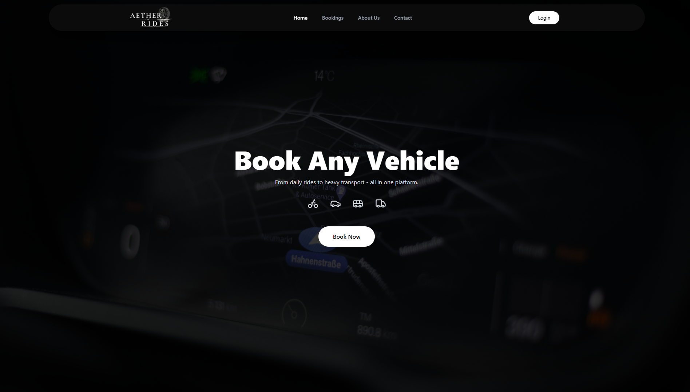
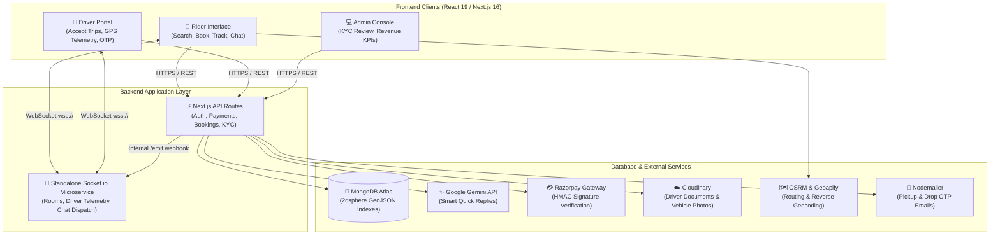

<div align="center">

# 🚖 AETHER RIDES
### *Next-Generation Real-Time Mobility & Autonomous Ride-Hailing Ecosystem*

[](https://nextjs.org/)
[](https://react.dev/)
[](https://www.typescriptlang.org/)
[](https://tailwindcss.com/)
[](https://socket.io/)
[](https://www.mongodb.com/)
[](https://ai.google.dev/)
[](https://razorpay.com/)

<br />

<p align="center">
  <b>Aether Rides</b> is a production-ready, enterprise-grade ride-sharing platform connecting riders, driver partners, and platform administrators in real time. Featuring geospatial driver matching within 5 km, live WebSocket GPS tracking, Gemini AI contextual chat suggestions, dual-OTP trip validation, and automated financial settlements.
</p>

[Explore Features](#-key-features) •
[Architecture](#-system-architecture) •
[Screenshots](#-product-showcase) •
[Getting Started](#-getting-started) •
[Environment Setup](#-environment-variables) •
[API Reference](#-api-routes--microservice-events)

<br />

---

<!-- HERO BANNER PLACEHOLDER -->
<p align="center">
  
</p>
<p align="center"><i>📸 Banner Placeholder: Add your primary hero preview / high-resolution mockup here!</i></p>

---

</div>

<br />

## 🌟 Product Highlights

- ⚡ **Low-Latency Real-Time Telemetry:** Powered by a dedicated Node.js + Socket.io microservice managing synchronized driver GPS coordinates, active trip rooms, and instant event routing.
- 📍 **Intelligent Geospatial Matching:** Built with MongoDB `2dsphere` GeoJSON indexing and `$near` queries to match passengers with approved drivers in a 5,000-meter radius in sub-50ms.
- 🗺️ **Turn-by-Turn Dynamic Routing:** Integrated with Leaflet, Geoapify geocoding, and Open Source Routing Machine (OSRM) to calculate precision distances and dynamic road polylines.
- 🤖 **Context-Aware Generative AI:** Integrated with Google Gemini API to analyze in-ride conversations and generate instantaneous 1-tap smart replies for riders and drivers.
- 🔐 **Zero-Trust Ride Security:** Dual-phase time-sensitive OTP verification (Pickup OTP to initiate trip, Drop OTP to conclude) delivered via transactional HTML emails.
- 💳 **Verified Financial Pipeline:** Instant Razorpay payment gateway integration with server-side HMAC-SHA256 signature verification and automated 90/10 driver-admin revenue split.
- 📋 **Driver Lifecycle & Admin Auditing:** End-to-end multi-step onboarding for drivers (banking details, vehicle specs, and Cloudinary KYC document verification) with an admin moderation center.

<br />

---

## 📸 Product Showcase

> [!TIP]
> **Recommended Screenshot Count: 6 to 8 images (or GIFs).**  
> We have pre-configured responsive image slots below. Save your screenshots inside a `docs/screenshots/` folder (or link to your uploaded cloud images) and they will immediately render cleanly in this gallery!

<br />

### 1. Passenger Experience & Real-Time Tracking

| 01. Route Planning & Upfront Pricing | 02. Live Driver GPS Tracking & Navigation |
| :---: | :---: |
|  |  |
| *Interactive Leaflet map with draggable pins and live distance calculation* | *Real-time driver location updates streamed via Socket.io* |

<br />

### 2. Smart In-Ride Communication & Trip Verification

| 03. Gemini AI-Powered In-Ride Chat | 04. Dual-OTP Ride Safety Verification |
| :---: | :---: |
|  |  |
| *Contextual 1-tap quick replies generated on-the-fly with Google Gemini* | *Expiring 4-digit PIN verification before ride start and ride completion* |

<br />

### 3. Driver Partner Portal & Admin Operations

| 05. Partner Onboarding & Document Upload | 06. Admin Analytics & Document Review |
| :---: | :---: |
|  |  |
| *Multi-step KYC: Vehicle registration, driving license, and bank details* | *Admin auditing station for approvals/rejections with revenue Recharts* |

<br />

---

## 🏛️ System Architecture

Aether Rides utilizes a decoupled hybrid architecture: Next.js handles server-rendered frontend components and business API logic, while a lightweight Express/Socket.io service handles persistent bi-directional communication.



<br />

---

## 💎 Key Features

### 🧑‍💼 Passenger (Rider) Features
- **Map-Based Route Search:** Search pickup and drop points with autocomplete via Geoapify and drag pins directly on the Leaflet map.
- **Dynamic Fare Calculation:** Instant price estimation computed based on vehicle tier (Bike, Auto, Sedan, SUV), base fare, and per-km pricing.
- **Geospatial Vehicle Discovery:** Automatically queries approved, active drivers located within a 5 km proximity.
- **Live Ride Tracking:** Real-time marker movements reflecting driver coordinates with smooth interpolations.
- **AI-Enhanced Chat:** Chat directly with the driver during an active ride, with instant 1-tap quick replies tailored to the ongoing situation.
- **Seamless Checkout:** Razorpay digital checkout supporting Cards, UPI, NetBanking, and cash on arrival.

### 🚗 Driver Partner Features
- **3-Step Onboarding Flow:** Upload personal identity proofs, driving license, vehicle registration papers (stored securely on Cloudinary), and bank details for automated disbursements.
- **Real-Time Booking Dispatch:** Instant audio-visual popup alert when a new ride is requested nearby, with accept/reject options.
- **Live Location Broadcasting:** Uses HTML5 Geolocation `watchPosition` with high accuracy to broadcast telemetry to the ride room.
- **OTP Verification Flow:** Prevents unauthorized pickups and validates trip completion through 4-digit verification pins.
- **Earnings & Trip History:** Detailed logs of completed rides with dynamic commission breakdown (90% driver share).

### 🛡️ Admin & Operational Controls
- **Partner KYC & Vehicle Moderation:** Review uploaded documents and vehicle registration with 1-click Approve / Reject decisions.
- **Revenue Analytics & Metrics:** Interactive charts built with Recharts displaying weekly transaction totals, platform commission (10%), and partner earnings.
- **Fleet Management:** Live overview of total, pending, approved, and inactive vehicles across categories.

<br />

---

## 🛠️ Tech Stack Breakdown

| Domain | Technologies Used |
| :--- | :--- |
| **Frontend** | **Next.js 16** (App Router), **React 19**, **TypeScript**, **Tailwind CSS v4** |
| **Animation & Icons** | **Motion** (Framer Motion), **Lucide React**, **React Icons** |
| **State Management** | **Redux Toolkit** (`@reduxjs/toolkit`), **React-Redux** |
| **Authentication** | **NextAuth.js v5 (Beta)**, **JWT**, **Bcrypt.js** |
| **Real-Time Engine** | **Socket.io** (Client & Server), **Express 5**, Node.js HTTP Server |
| **Database & ODM** | **MongoDB Atlas**, **Mongoose 9** (2dsphere geospatial indexing) |
| **Maps & Routing** | **Leaflet**, **React-Leaflet**, **Geoapify API**, **Project OSRM** |
| **AI Integration** | **Google Gemini API** (contextual response generation) |
| **Payments** | **Razorpay SDK** (HMAC-SHA256 signature verification) |
| **Media & Emails** | **Cloudinary v2**, **Nodemailer** (custom HTML OTP templates) |
| **Data Visualization** | **Recharts** |

<br />

---

## 📂 Repository Structure

The repository is structured into two main workspaces: the Next.js full-stack application and the standalone WebSocket microservice.

```bash
Aether-Rides/
├── aether-ride/                # Next.js 16 Full-Stack Application
│   ├── public/                 # Static assets, branding, and icons
│   ├── src/
│   │   ├── app/                # Next.js App Router (Pages & API Handlers)
│   │   │   ├── admin/          # Admin moderation and KYC review pages
│   │   │   ├── partner/        # Driver onboarding, active ride, and earnings
│   │   │   ├── user/           # Rider search, booking, checkout, and tracking
│   │   │   └── api/            # Serverless REST API endpoints
│   │   │       ├── admin/      # Metrics, document approval/rejection routes
│   │   │       ├── booking/    # Ride creation, confirmation, and status routes
│   │   │       ├── chat/       # In-ride messages & Gemini AI suggestions
│   │   │       ├── partner/    # Driver onboarding and OTP dispatch/verify
│   │   │       ├── payment/    # Razorpay order generation and HMAC verification
│   │   │       └── vehicles/   # Geospatial $near nearby driver queries
│   │   ├── components/         # Reusable UI, Map components, and Modals
│   │   ├── features/           # Modular domain components (Auth, Partner, Admin)
│   │   ├── lib/                # Database connection, auth, Razorpay, Cloudinary
│   │   │   └── emailTemplates/ # Responsive HTML templates for OTPs & verification
│   │   ├── models/             # Mongoose schemas (User, Vehicle, Booking, Chat)
│   │   └── redux/              # Redux slices and global store configuration
│   ├── package.json
│   └── tsconfig.json
│
├── SocketServer/               # Real-Time Telemetry & Chat Microservice
│   ├── models/                 # Shared User Mongoose model for socket identity
│   ├── index.js                # Express + Socket.io server with /emit webhook
│   └── package.json
│
└── README.md                   # Project documentation
```

<br />

---

## 🚀 Getting Started

Follow the steps below to run both the **Aether Rides** frontend application and the **SocketServer** microservice locally.

### Prerequisites

- **Node.js**: `v20.x` or higher
- **npm**, **yarn**, or **pnpm**
- **MongoDB Atlas** account (or local MongoDB with 2dsphere indexing support)
- Free accounts for: [Geoapify](https://www.geoapify.com/), [Cloudinary](https://cloudinary.com/), [Razorpay (Test Mode)](https://razorpay.com/), and [Google AI Studio](https://aistudio.google.com/)

---

### Step 1: Clone the Repository

```bash
git clone https://github.com/your-username/aether-rides.git
cd aether-rides
```

---

### Step 2: Configure Environment Variables

#### 1. Setup `aether-ride/.env`
Navigate to the `aether-ride/` directory and create your `.env` file:

```env
# Database
MONGO_DB_URI=mongodb+srv://<username>:<password>@cluster.mongodb.net/aether-rides?retryWrites=true&w=majority

# Authentication
AUTH_SECRET=your_super_secret_auth_key
AUTH_GOOGLE_ID=your_google_oauth_client_id
AUTH_GOOGLE_SECRET=your_google_oauth_client_secret
BACKEND_URL=http://localhost:3000

# Email (Nodemailer)
AETHER_EMAIL=your_email@gmail.com
PASS=your_email_app_password

# Cloudinary (Driver KYC & Document Uploads)
CLOUDINARY_CLOUD_NAME=your_cloudinary_cloud_name
CLOUDINARY_API_KEY=your_cloudinary_api_key
CLOUDINARY_API_SECRET=your_cloudinary_api_secret

# Maps & Geolocation
NEXT_PUBLIC_GEOAPIFY_API_KEY=your_geoapify_api_key

# Real-Time Socket Microservice
NEXT_PUBLIC_SOCKET_URL=http://localhost:5000

# Razorpay Payments
RAZORPAY_API_KEY=rzp_test_your_key
RAZORPAY_KEY_SECRET=your_key_secret
NEXT_PUBLIC_RAZORPAY_API_KEY=rzp_test_your_key

# Google Gemini AI (Smart Chat Suggestions)
GEMINI_API_URL=https://generativelanguage.googleapis.com/v1beta/models/gemini-1.5-flash:generateContent?key=YOUR_GEMINI_API_KEY
```

#### 2. Setup `SocketServer/.env`
Navigate to the `SocketServer/` directory and create its `.env` file:

```env
PORT=5000
NEXT_BASE_URL=http://localhost:3000
MONGO_DB_URI=mongodb+srv://<username>:<password>@cluster.mongodb.net/aether-rides?retryWrites=true&w=majority
```

---

### Step 3: Install Dependencies & Run

We recommend opening two terminal tabs:

#### Terminal 1: Run the WebSocket Server
```bash
cd SocketServer
npm install
npm run dev
# Server will start on http://localhost:5000
```

#### Terminal 2: Run the Next.js Application
```bash
cd aether-ride
npm install
npm run dev
# Application will launch on http://localhost:3000
```

Open your browser and navigate to **`http://localhost:3000`**.

<br />

---

## 📡 API Routes & Microservice Events

### Next.js Core Endpoints

| Method | Endpoint | Description |
| :--- | :--- | :--- |
| `POST` | `/api/vehicles/near-by` | Finds active, approved vehicles within 5 km using `$near` GeoJSON |
| `POST` | `/api/booking/create` | Initiates ride booking and notifies driver via socket trigger |
| `POST` | `/api/payment/create` | Generates a Razorpay payment order for upfront trip cost |
| `POST` | `/api/payment/verify` | Verifies cryptographic HMAC-SHA256 signature and confirms ride |
| `POST` | `/api/partner/bookings/otp/pickup/send` | Dispatches 4-digit pickup code to user's email |
| `POST` | `/api/partner/bookings/otp/pickup/verify` | Validates pickup code and starts the ride |
| `POST` | `/api/chat/ai-suggestions` | Google Gemini endpoint delivering role-based quick reply suggestions |
| `GET` | `/api/admin/dashboard` | Returns operational KPIs, pending KYC lists, and vehicle counts |
| `GET` | `/api/admin/earning` | Returns 7-day revenue aggregates and platform commission stats |

### Socket.io Microservice Events

| Event Name | Direction | Payload | Description |
| :--- | :--- | :--- | :--- |
| `identity` | Client ➔ Server | `userId` | Registers client socket ID and sets user online in DB |
| `updateLocation` | Client ➔ Server | `{ userId, latitude, longitude }` | Updates live driver coordinates in MongoDB |
| `join-ride` | Client ➔ Server | `bookingId` | Joins private room `ride-${bookingId}` for the trip |
| `driver-location-update` | Client ➔ Server | `{ bookingId, latitude, longitude }` | Broadcasts driver position to the ride room |
| `driver-location` | Server ➔ Client | `{ latitude, longitude }` | Ingested by rider map to animate driver marker |
| `chat-message` | Bi-directional | `{ bookingId, sender, text }` | Broadcasts in-ride messages instantly to both parties |

<br />

---

## 🛡️ Security Highlights

1. **HMAC-SHA256 Cryptographic Verification:** All payment webhooks and confirmation requests compute an SHA-256 HMAC digest against Razorpay secret keys, preventing payment spoofing and replay attacks.
2. **Ephemeral OTP Lifecycle:** Trip security PINs automatically expire after 5 minutes, mitigating reuse or brute-force risks.
3. **Decoupled Sensitive Credentials:** High-privilege API keys (Razorpay Secret, Cloudinary Secret, Gemini Key) are strictly executed in server-side Next.js functions and never exposed to the client bundle.
4. **Role-Based Route Protection:** NextAuth v5 session guards ensure riders, drivers, and admins can only access their authorized portals and actions.

<br />

---

## 🔮 Future Roadmap

- [ ] **Native Mobile Apps:** React Native / Expo companion apps for iOS and Android.
- [ ] **Multi-Stop Trips:** Allow riders to add intermediate waypoints during ride planning.
- [ ] **Dynamic Surge Pricing:** Automated surge fare multiplier based on active rider demand vs. available driver density.
- [ ] **Voice-Activated Commands:** Voice-based booking and emergency hands-free driver updates.
- [ ] **Emergency SOS System:** 1-tap SOS trigger alerting emergency contacts with live tracking link.

<br />

---

## 📄 License

Distributed under the **MIT License**. See `LICENSE` for more information.

<br />

---

<div align="center">
  <sub>Designed & Developed with ❤️ by <b>Your Name</b>. If you like this project, please consider giving it a ⭐ on GitHub!</sub>
</div>
