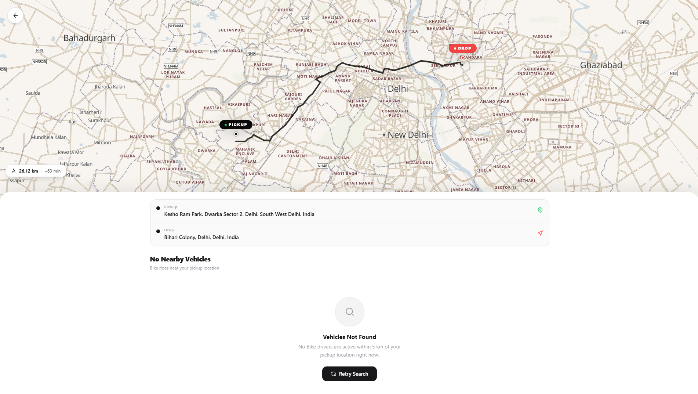
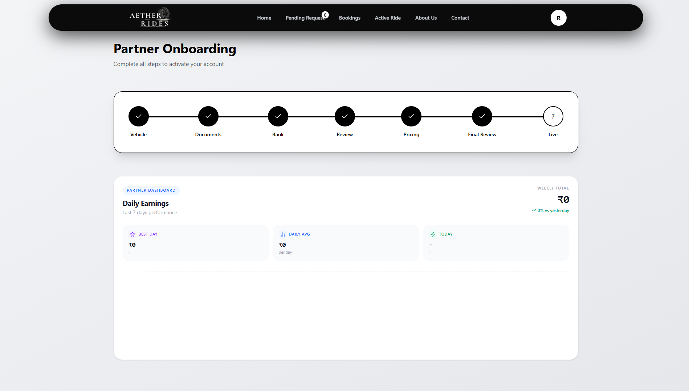
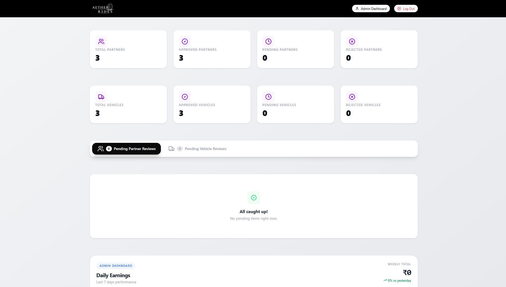
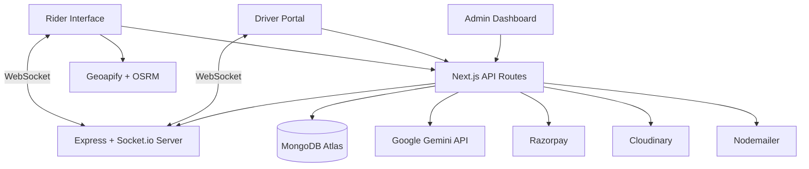

# Aether Rides

Aether Rides is a ride-booking platform built with Next.js, React, Node.js and MongoDB. It has three types of users: riders, drivers and administrators.

Riders can search for nearby vehicles, book rides, track drivers and make payments. Drivers can manage ride requests, share their live location and view their earnings. Admins can review driver registrations, manage vehicles and check platform activity.

The application also uses Socket.io for real-time updates and Google Gemini for suggested replies in the in-ride chat.

## Screenshots

### Home

<p align="center">
  
</p>

### Find nearby vehicles

<p align="center">
  
</p>

### Driver onboarding

<p align="center">
  
</p>

### Admin dashboard

<p align="center">
  
</p>

## Features

### Rider
- Search for pickup and drop-off locations using Geoapify autocomplete.
- View routes on an interactive Leaflet map.
- See nearby available, approved drivers within a 5 km radius.
- Get an estimated fare based on vehicle type and distance.
- Track the assigned driver's location in real time.
- Chat with the driver during an active ride.
- Get suggested chat replies using Google Gemini.
- Pay online through Razorpay or choose cash.

### Driver
- Register and submit personal, vehicle and bank details.
- Upload identity and vehicle documents for admin review.
- Receive nearby ride requests in real time.
- Accept or reject incoming bookings.
- Share GPS location during an active ride.
- Verify pickup and drop-off using OTPs.
- View completed rides and earnings.

### Admin
- Review driver registrations and uploaded documents.
- Approve or reject driver applications.
- Manage registered vehicles.
- View platform earnings and driver payouts.
- Check booking and platform statistics.

## Ride booking flow

1. The rider selects pickup and drop-off locations.
2. The application calculates an estimated fare based on the selected vehicle.
3. Nearby approved drivers are fetched using MongoDB geospatial queries.
4. A ride request is sent to a driver.
5. The driver can accept or reject the request.
6. Once accepted, the rider can track the driver's location through Socket.io.
7. A pickup OTP is verified before the trip starts.
8. A second OTP is used to confirm trip completion.
9. The payment and driver earnings are recorded.

## Real-time communication

A separate Express and Socket.io server handles real-time communication between riders and drivers. It is used for:

- Sending driver location updates.
- Notifying drivers about new ride requests.
- Managing private rooms for individual rides.
- Delivering chat messages between riders and drivers.
- Updating the rider's map when the driver's location changes.

The Next.js application communicates with this server through HTTP endpoints, while rider and driver interfaces connect through WebSockets.

## AI chat suggestions

The Google Gemini API is used to generate quick replies during an active ride. Riders and drivers can select a suggested response instead of typing every message themselves. Suggestions are requested through a dedicated API endpoint.

## Payments

Razorpay is used for online payments. The application creates payment orders on the server and verifies payment signatures using HMAC-SHA256 before confirming a transaction.

The current revenue split is configured as:
- Driver: 90%
- Platform: 10%

Cash payments are also supported.

## Security

- **Payment verification:** Razorpay payment signatures are verified on the server using HMAC-SHA256.
- **OTP verification:** Separate pickup and drop-off OTPs are used to validate the start and completion of rides. OTPs expire after 5 minutes.
- **Protected credentials:** API secrets are kept in server-side environment variables.
- **Role-based access:** Rider, driver and admin sections are protected based on user roles.
- **Driver verification:** Driver documents are reviewed before an account is approved.

## System architecture

The project has two main parts:

1. **Next.js application:** Handles the user interface, authentication, bookings, payments, driver onboarding and application APIs.
2. **Socket.io server:** Handles real-time events such as location updates, ride notifications and chat messages.

MongoDB Atlas is used as the database. External services are used for maps, payments, document storage, email delivery and AI chat suggestions.



## Tech stack

| Area | Technologies |
|---|---|
| Frontend | Next.js 16, React 19, TypeScript, Tailwind CSS |
| State management | Redux Toolkit, React-Redux |
| Authentication | NextAuth.js v5, JWT, Bcrypt.js |
| Backend | Next.js API Routes, Node.js, Express 5 |
| Real-time communication | Socket.io |
| Database | MongoDB Atlas, Mongoose |
| Maps and routing | Leaflet, React-Leaflet, Geoapify, OSRM |
| AI integration | Google Gemini API |
| Payments | Razorpay |
| File storage | Cloudinary |
| Email | Nodemailer |
| Charts | Recharts |

## Project structure

```text
Aether-Rides/
├── aether-ride/
│   ├── public/
│   ├── src/
│   │   ├── app/
│   │   │   ├── admin/
│   │   │   ├── partner/
│   │   │   ├── user/
│   │   │   └── api/
│   │   │       ├── admin/
│   │   │       ├── booking/
│   │   │       ├── chat/
│   │   │       ├── partner/
│   │   │       ├── payment/
│   │   │       └── vehicles/
│   │   ├── components/
│   │   ├── features/
│   │   ├── lib/
│   │   │   └── emailTemplates/
│   │   ├── models/
│   │   └── redux/
│   ├── package.json
│   └── tsconfig.json
├── SocketServer/
│   ├── models/
│   ├── index.js
│   └── package.json
├── docs/
│   └── screenshots/
│       ├── hero-banner.png
│       ├── search.png
│       ├── driver-onboarding.png
│       └── admin-dashboard.png
└── README.md
```

## Getting started

### Prerequisites

- Node.js 20 or later
- npm, yarn or pnpm
- MongoDB Atlas account, or a local MongoDB instance

You will also need API credentials for:
- [Geoapify](https://www.geoapify.com/)
- [Cloudinary](https://cloudinary.com/)
- [Razorpay](https://razorpay.com/)
- [Google AI Studio](https://aistudio.google.com/)

### 1. Clone the repository

```bash
git clone https://github.com/your-username/aether-rides.git
cd aether-rides
```

### 2. Configure environment variables

Create a `.env` file inside the `aether-ride` directory.

**`aether-ride/.env`**

```env
# Database
MONGO_DB_URI=mongodb+srv://<username>:<password>@cluster.mongodb.net/aether-rides?retryWrites=true&w=majority

# Authentication
AUTH_SECRET=your_auth_secret
AUTH_GOOGLE_ID=your_google_oauth_client_id
AUTH_GOOGLE_SECRET=your_google_oauth_client_secret
BACKEND_URL=http://localhost:3000

# Email
AETHER_EMAIL=your_email@gmail.com
PASS=your_email_app_password

# Cloudinary
CLOUDINARY_CLOUD_NAME=your_cloudinary_cloud_name
CLOUDINARY_API_KEY=your_cloudinary_api_key
CLOUDINARY_API_SECRET=your_cloudinary_api_secret

# Maps
NEXT_PUBLIC_GEOAPIFY_API_KEY=your_geoapify_api_key

# Socket server
NEXT_PUBLIC_SOCKET_URL=http://localhost:5000

# Razorpay
RAZORPAY_API_KEY=rzp_test_your_key
RAZORPAY_KEY_SECRET=your_key_secret
NEXT_PUBLIC_RAZORPAY_API_KEY=rzp_test_your_key

# Gemini
GEMINI_API_URL=https://generativelanguage.googleapis.com/v1beta/models/gemini-1.5-flash:generateContent?key=YOUR_GEMINI_API_KEY
```

Create another `.env` file inside `SocketServer`.

**`SocketServer/.env`**

```env
PORT=5000
NEXT_BASE_URL=http://localhost:3000
MONGO_DB_URI=mongodb+srv://<username>:<password>@cluster.mongodb.net/aether-rides?retryWrites=true&w=majority
```

### 3. Install dependencies and run the servers

Use two terminals.

**Terminal 1 – Socket server**

```bash
cd SocketServer
npm install
npm run dev
```

The Socket.io server runs at `http://localhost:5000`.

**Terminal 2 – Next.js application**

```bash
cd aether-ride
npm install
npm run dev
```

The Next.js application runs at `http://localhost:3000`.

Open `http://localhost:3000` in your browser.

## API routes

| Method | Endpoint | Purpose |
|---|---|---|
| POST | `/api/vehicles/near-by` | Find nearby approved vehicles |
| POST | `/api/booking/create` | Create a ride booking |
| POST | `/api/payment/create` | Create a Razorpay payment order |
| POST | `/api/payment/verify` | Verify payment signature |
| POST | `/api/partner/bookings/otp/pickup/send` | Send pickup OTP |
| POST | `/api/partner/bookings/otp/pickup/verify` | Verify pickup OTP |
| POST | `/api/chat/ai-suggestions` | Generate chat suggestions |
| GET | `/api/admin/dashboard` | Fetch dashboard statistics |
| GET | `/api/admin/earning` | Fetch earnings data |

## Socket.io events

| Event | Direction | Purpose |
|---|---|---|
| `identity` | Client → Server | Register the connected user's socket |
| `updateLocation` | Client → Server | Update driver coordinates |
| `join-ride` | Client → Server | Join a ride-specific room |
| `driver-location-update` | Client → Server | Send driver location to the server |
| `driver-location` | Server → Client | Update the rider's map |
| `chat-message` | Both ways | Exchange messages during a ride |

## Planned improvements

- Mobile applications using React Native or Expo.
- Multiple stops in a single trip.
- Fare adjustments based on demand and driver availability.
- Voice-based booking and controls.
- An SOS feature with emergency contact notifications and live location sharing.

## License

This project is distributed under the MIT License. See the `LICENSE` file for details.
